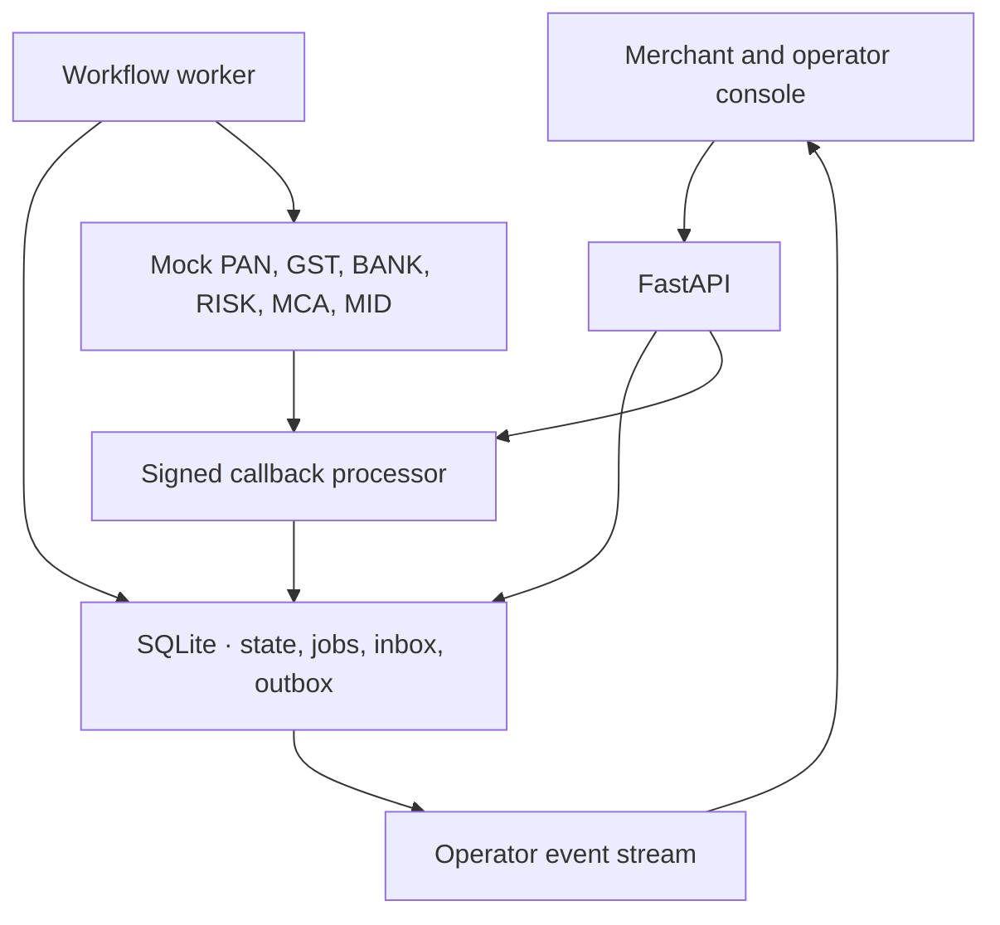

# Merchant Onboarding Pipeline

A local demo of merchant onboarding in the Indian payments context, from document intake to a simulated merchant ID and payment capabilities. It includes a merchant portal, an operator console, signed mock provider callbacks, and a review workflow.

## Run locally

Use Python 3.12 or newer.

```bash
python -m venv .venv
source .venv/bin/activate
python -m pip install -r requirements.txt
python -m uvicorn onboarding.api:app --host 127.0.0.1 --port 8000
```

On Windows PowerShell, activate the environment with `\.venv\Scripts\Activate.ps1`.

Open [the console](http://127.0.0.1:8000) or [the route reference](http://127.0.0.1:8000/docs). Keep the demo bound to localhost and use synthetic data. Demo identities are selected by headers and can impersonate each other. Run a single Uvicorn worker. SQLite persists jobs, transitions, the callback inbox, and the event outbox across ordinary restarts.

## Five-minute demo

1. Run **Straight-through approval**. The timeline reaches `ACTIVE` after PAN, GST, bank, risk, and MCA checks. The callback metric counts the repeated PAN event once as a duplicate.
2. Run **Cancelled GST registration**. The case reaches `MANUAL_REVIEW`. Choose **REQUEST_INFO** in the operator console with a reason and an information item. In the merchant portal, load status and respond with an updated GSTIN and an updated structured GST certificate. The [automated recovery example](tests/test_onboarding.py) shows a checksum-valid correction.
3. Open **Metrics** and **Verify audit**. For recovery after provider or provisioning errors, run the MID failure fixture. After its five attempts, retry provisioning with the simulated fault cleared or replay the provisioning dead letter through the API.
4. For four-eyes review, request a settlement bank change on an active fixture. After bank verification, an admin proposes approval. Select **Second admin** and choose **CONFIRM**. The original account remains active until confirmation.

Create a fresh local data directory with `ONBOARDING_STORAGE` when repeating fixtures that would match a previous application.

## Architecture



The pure transition table validates state and guard inputs. The workflow writes each transition, audit record, and outbox event in the same SQLite transaction. The scheduler processes persisted jobs under SQLite's write lock. The outbox relay exposes committed events through server-sent events. The mock callback path and the public callback endpoint share the same HMAC verification and inbox handler.

| Component | Location |
|---|---|
| Application, document and callback APIs | [onboarding/api.py](onboarding/api.py) |
| Workflow, document handling and deduplication | [onboarding/workflow.py](onboarding/workflow.py) |
| Transitions, format checks and decision rules | [onboarding/domain.py](onboarding/domain.py) |
| Provider attempts, callbacks and provisioning | [onboarding/providers.py](onboarding/providers.py) |
| Review, four-eyes and settlement changes | [onboarding/operators.py](onboarding/operators.py) |
| Policies and provider timing | [config/onboarding.yaml](config/onboarding.yaml) |
| Synthetic demo cases | [fixtures/applications](fixtures/applications) |
| Specification review and API examples | [docs/implementation.md](docs/implementation.md) |

The demo uses one legal entity and one active settlement account per application. Amounts use INR. The public repository contains implementation code and synthetic fixtures. Provider mocks never contact a bank, bureau, tax authority, or payment network. Structured extraction runs locally and decisions use deterministic rules.

To run the tests:

```bash
python -m unittest discover -s tests -v
```

The suite covers all nine supplied fixture paths, both outcomes of the pure guard for all 38 transition entries, callback handling, idempotency, ownership, multipart validation, restart recovery, and audit verification.
